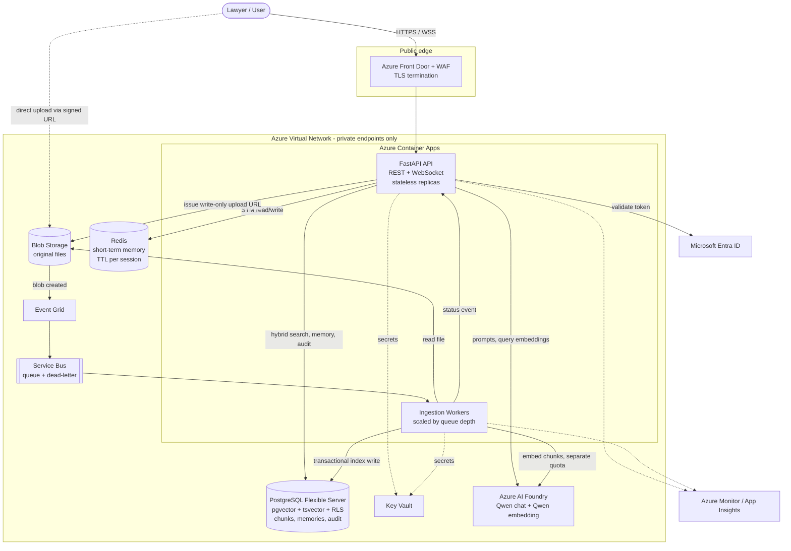
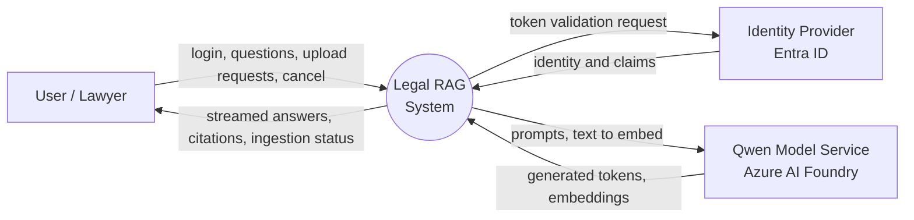
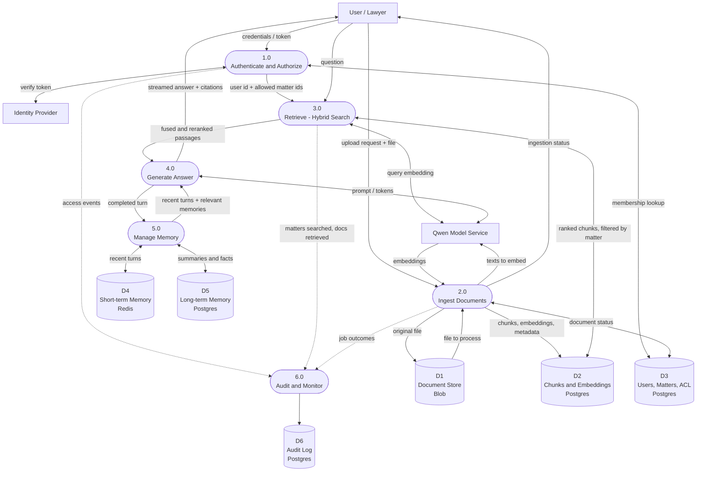
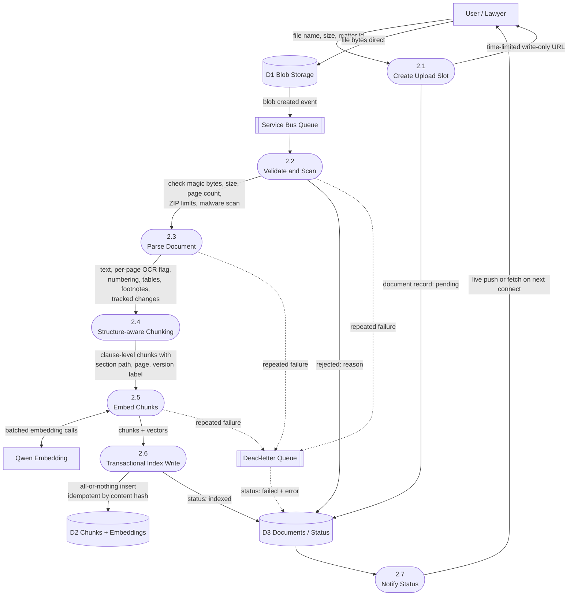
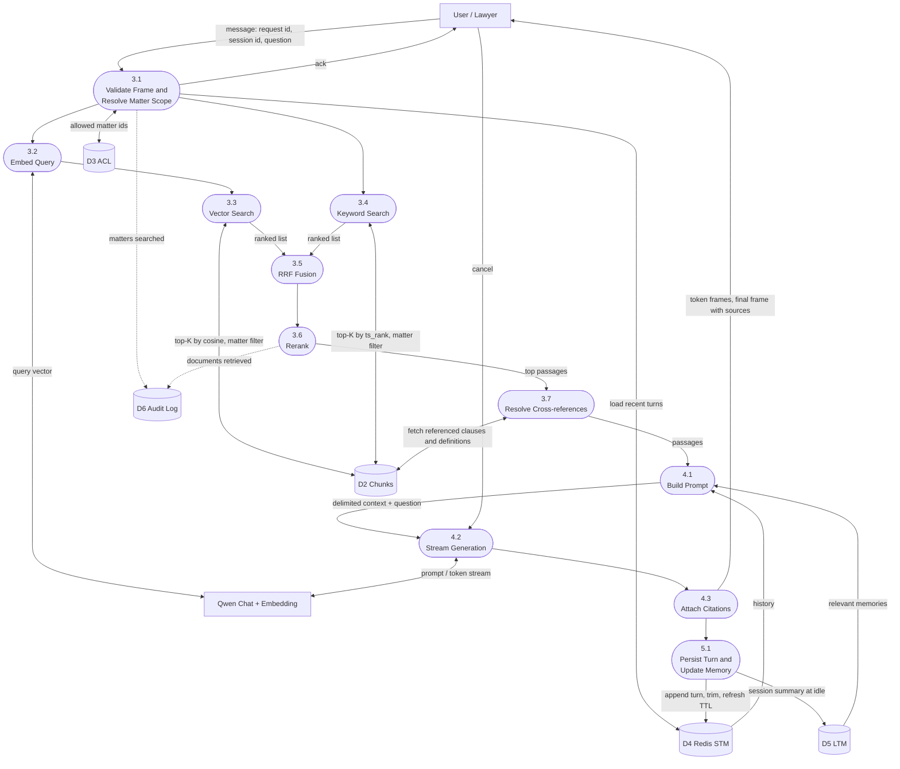
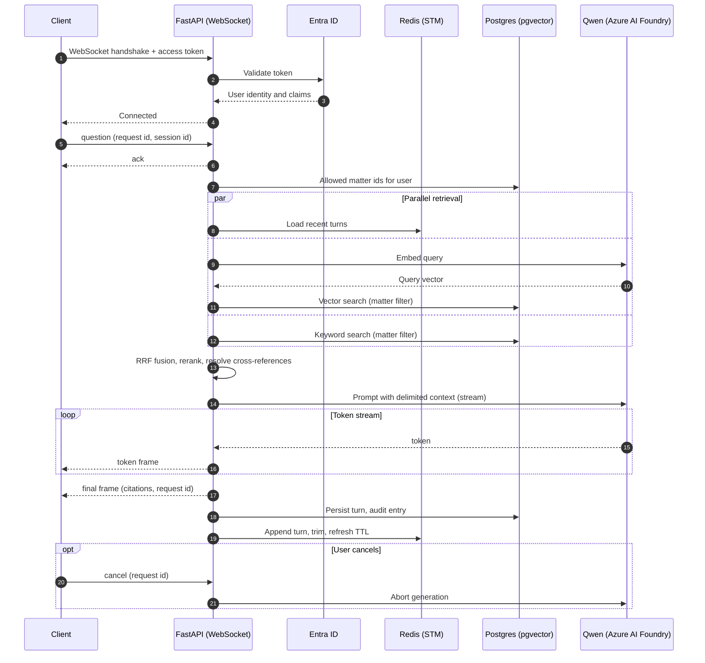
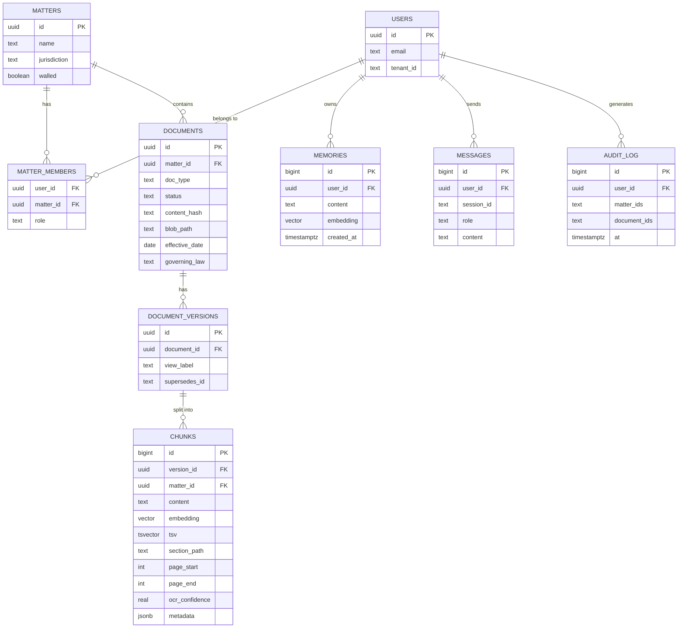

# Legal RAG: Hybrid Search Assistant for Legal Documents

A retrieval-augmented generation (RAG) system for searching and questioning legal documents (PDF and DOCX) with **pinpoint citations**. It combines **hybrid retrieval** (pgvector semantic search + Postgres full-text search, fused with Reciprocal Rank Fusion), **structure-aware legal chunking**, **multi-matter access control**, and **streaming answers over WebSocket**, powered by **Qwen** on Azure.

> **Disclaimer:** This is a research-assistance tool. Output must be verified against the source documents by a qualified professional. It does not provide legal advice.

---

## Table of Contents

1. [Features](#features)
2. [Scope and Assumptions](#scope-and-assumptions)
3. [Tech Stack](#tech-stack)
4. [System Design Diagram](#system-design-diagram)
5. [Data Flow Diagrams](#data-flow-diagrams)
6. [Chat Sequence](#chat-sequence)
7. [Data Model](#data-model)
8. [Key Design Decisions](#key-design-decisions)
9. [Security](#security)
10. [Scalability and Responsiveness](#scalability-and-responsiveness)
11. [Evaluation](#evaluation)
12. [Project Structure](#project-structure)
13. [Configuration](#configuration)
14. [Roadmap](#roadmap)

---

## Features

- **Hybrid search**: dense vectors (pgvector, HNSW) plus keyword search (`tsvector`, GIN), fused with RRF, followed by a reranker.
- **Legal-aware ingestion**: preserves clause numbering (1.1, 1.1(a), (i)), headings, tables, footnotes, headers and footers.
- **Tracked-changes dual index**: DOCX files with tracked changes are indexed as an *accepted* view (default) and an *original* view, each labeled.
- **Pinpoint citations**: every claim links to matter, document, page, and clause path.
- **Multi-matter search**: a user can query several matters at once, enforced by Postgres row-level security.
- **WebSocket chat**: token streaming, acknowledgements, cancellation, and reconnect handling.
- **Memory**: short-term memory in Redis (recent turns, TTL); long-term memory in Postgres (summaries and facts with embeddings).
- **Async ingestion**: direct-to-blob upload, queue-driven workers, explicit processing states, retries, and a dead-letter queue.
- **Auditability**: logs who searched which matters and which documents were retrieved.

## Scope and Assumptions

| Item | Decision |
|---|---|
| Accepted formats | `.pdf` and `.docx` only, validated by content signature, not extension |
| Max file size | 5 MB per file, plus a page-count cap and ZIP decompression limits for DOCX |
| Scanned PDFs | Detected per page. Minimal OCR (Tesseract) or rejected with a clear message in v1 |
| Tracked changes | Both *accepted* and *original* versions indexed, labeled per chunk |
| Matter access | Multi-matter queries, restricted to matters the user is a member of |
| Design scale (stated assumption) | About 50 matters, 5,000 documents, about 20 pages average, roughly 10% scanned |
| Corpus | Public data only (for example CUAD contracts, SEC EDGAR exhibits, open templates). No real client data |

The scale figures are a stated design target for testing, not measurements from real usage.

## Tech Stack

| Layer | Technology |
|---|---|
| API | Python, FastAPI (REST + WebSocket) |
| LTM and search | Azure Database for PostgreSQL Flexible Server, pgvector, tsvector |
| STM | Redis (Azure Cache for Redis in production; container locally) |
| LLM and embeddings | Qwen via Azure AI Foundry (verify model and region availability) |
| File storage | Azure Blob Storage |
| Async pipeline | Event Grid, Service Bus (with DLQ), Container Apps jobs scaled by KEDA |
| Auth | Microsoft Entra ID (JWT validated on WebSocket handshake) |
| Secrets and identity | Managed identities, Key Vault |
| Observability | Azure Monitor / Application Insights, trace IDs end to end |

---

## System Design Diagram



> **MVP simplification:** For a personal deployment, skip Front Door, Web PubSub, and Azure Cache for Redis (run Redis as a container) and use burstable or scale-to-zero SKUs. The diagram shows the production target.

---

## Data Flow Diagrams

Notation: rectangles are external entities, rounded shapes are processes, cylinders are data stores.

### DFD Level 0: Context Diagram



### DFD Level 1: Major Processes



### DFD Level 2: Process 2.0 Ingest Documents



### DFD Level 2: Process 3.0 and 4.0 Retrieve and Generate



---

## Chat Sequence



---

## Data Model



`view_label` is `accepted` or `original`. Documents with no tracked changes store a single view. `matter_id` is denormalized onto `chunks` so row-level security and filtered index scans do not need a join.

---

## Key Design Decisions

| Decision | Rationale | Trade-off |
|---|---|---|
| **Redis for STM, Postgres for LTM** | STM is hot, small, and expiring; Redis gives sub-millisecond reads and native TTL. Postgres is the durable source of truth. | One more service to run |
| **Hybrid search in Postgres** | One datastore for vectors and keywords, transactional writes, no separate search engine | Less sophisticated keyword ranking than true BM25 (can add `pg_search` if allowed) |
| **RRF fusion** | Uses ranks, so no score normalization across vector and keyword results | Ignores score magnitude |
| **Index HNSW top-K directly, rank afterwards** | Ranking over the whole table with a window function defeats the index | Needs `EXPLAIN ANALYZE` verification |
| **Filtered-search handling** | Selective matter filters with HNSW can return too few rows. Use pgvector iterative scans or partition by matter | Added tuning and testing |
| **Structure-aware chunking** | Clauses and definitions lose meaning when split by token count | More parsing logic |
| **Dual index for tracked changes** | Prevents quoting deleted language as current terms | Larger index when tracked changes exist |
| **Direct-to-blob upload** | Files bypass API servers, so large uploads cannot block chat | More moving parts |
| **Queue-driven workers** | Absorbs bursts, retries, isolates ingestion from chat | Eventual consistency of document status |
| **Separate embedding quota for ingestion** | Bulk embedding cannot starve chat | Extra deployment to manage |
| **Transactional document writes** | A document is fully searchable or not at all | Larger transactions for big documents |

## Security

- **Network:** Postgres, Redis, Blob, and the model endpoint are reachable only through private endpoints. The public edge is the only internet-facing surface.
- **Identity:** Entra ID tokens validated on the WebSocket handshake; user identity always comes from the token, never from message payloads. Services use managed identities; remaining secrets live in Key Vault.
- **Authorization:** Row-level security on `chunks`, `documents`, and `memories`, scoped by matter membership. Ethical walls exclude walled matters even for firm members. Enforced in the API and the workers.
- **Upload safety:** Magic-byte validation, 5 MB cap, page cap, ZIP decompression limits (uncompressed size, entry count, nesting), parsing in a sandboxed worker with time and memory limits, malware scanning.
- **WebSocket hardening:** Origin check, frame size and schema validation, per-user and per-connection rate limits, heartbeats.
- **Prompt injection:** Retrieved text is untrusted. It is placed in a delimited context block and treated as data; the model has no side-effecting tools.
- **Data protection:** Encryption at rest and in transit. No document text or prompts in logs; IDs, latencies, and error codes only.
- **Cache and memory isolation:** STM and any answer cache are keyed by user and the set of matters searched.
- **Deletion:** Deleting a document removes its chunks, embeddings, cache entries, and related memories together.
- **Model data handling:** Confirm the Qwen deployment does not retain prompts or outputs and that processing region meets residency needs.

## Scalability and Responsiveness

**Scalability**
- API replicas are stateless; session state lives in Redis. Scale on concurrent WebSocket connections.
- If one replica must push to a socket held by another, add a pub/sub layer (Azure Web PubSub is a managed option).
- Workers scale independently on queue depth (KEDA).
- Postgres uses pooling (PgBouncer or the built-in pooler); scale compute first, add a read replica for retrieval if needed. Size memory so the HNSW index fits in RAM.
- Per-user token rate limits protect shared model quota.

**Responsiveness**
- Token streaming minimizes time to first token.
- Vector and keyword retrieval, STM load, and LTM lookup run in parallel.
- Immediate ack after each message; persistence happens after the stream ends.
- Cancellation aborts in-flight generation.
- Request IDs allow safe resume or discard after reconnect.
- Query embedding cache for repeated questions (keyed by matter scope).

**Failure behavior**
- Socket drop mid-answer: client reconnects with session and last request id; server resends the stored answer or reports the interruption.
- Model timeout: error frame, and the turn is not recorded as successful.
- Worker crash: transactional write leaves nothing partial; the message returns to the queue.

## Evaluation

Retrieval quality is measured, not assumed. The harness runs question-to-expected-clause pairs (built from CUAD's labeled clauses) against each retrieval mode.

| Mode | Recall@5 | Recall@10 | MRR |
|---|---|---|---|
| Vector only | not yet measured | not yet measured | not yet measured |
| Keyword only | not yet measured | not yet measured | not yet measured |
| Hybrid (RRF) | not yet measured | not yet measured | not yet measured |
| Hybrid + rerank | not yet measured | not yet measured | not yet measured |

Fill this table with real results once the harness runs. Also track time to first token, retrieval latency, queue age, and document failure rate.

## Project Structure

Planned layout:

```
legal-rag/
├── app/
│   ├── api/            # REST + WebSocket handlers
│   ├── retrieval/      # hybrid search, fusion, rerank
│   ├── memory/         # STM (Redis) and LTM (Postgres)
│   ├── security/       # token validation, matter scoping
│   └── prompts/        # prompt templates, citation rules
├── workers/
│   └── ingestion/      # validate, parse, chunk, embed, index
├── db/
│   └── migrations/     # schema, indexes, RLS policies
├── eval/               # evaluation harness and datasets
├── infra/              # IaC for Azure resources
├── docs/               # diagrams and design notes
└── README.md
```

## Configuration

| Variable | Purpose |
|---|---|
| `PG_DSN` | PostgreSQL connection string |
| `REDIS_URL` | Redis connection string |
| `QWEN_ENDPOINT` / `QWEN_KEY` | Model endpoint (prefer managed identity or Key Vault) |
| `QWEN_MODEL` / `EMBED_MODEL` | Chat and embedding deployment names |
| `BLOB_ACCOUNT_URL` | Storage account for original files |
| `SERVICEBUS_NAMESPACE` | Ingestion queue namespace |
| `ENTRA_TENANT_ID` / `ENTRA_AUDIENCE` | Token validation settings |
| `MAX_UPLOAD_MB` | Upload size limit (default 5) |
| `STM_TURNS` / `STM_TTL_SECONDS` | Short-term memory window and expiry |

The embedding dimension in the schema must match the embedding model. Changing the embedding model later requires re-embedding all content.

## Roadmap

1. Ingestion for digital PDFs and DOCX with structure-aware chunking
2. Schema, hybrid retrieval, and the evaluation harness
3. WebSocket chat with streaming and citations
4. Matter-based access control (RLS), ethical walls, audit logging
5. Reranking, tracked-changes dual index, scanned-page detection
6. Azure deployment and observability
7. Later: OCR with Azure Document Intelligence, amendment and supersession tracking, contract clause extraction

## License

Choose a license (for example MIT) before publishing.
